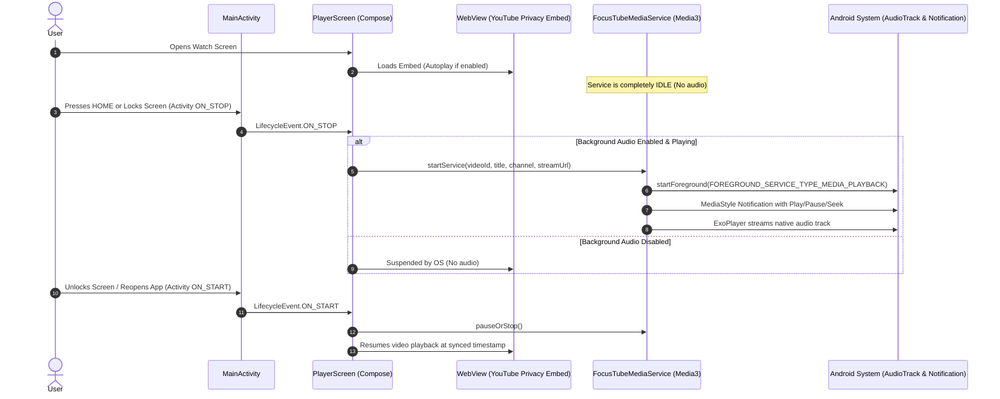

# FocusTube V5/V6: Background Playback Diagnostics & Architecture

## 1. Executive Summary

Background playback on Android 14+ (API 34/35) requires strict adherence to system lifecycle states, foreground service permissions (`FOREGROUND_SERVICE_MEDIA_PLAYBACK`), and an active `MediaSession`.

This document details the root cause of **Bug 2 (Unexpected Audio)**, the lifecycle decoupling between the foreground UI (`PlayerScreen.kt`) and `FocusTubeMediaService`, and how FocusTube guarantees persistent, uninterrupted audio playback when the screen is locked or the application is minimized without prematurely triggering audio or leaking background processes.

---

## 2. Root Cause Analysis: Bug 2 (Unexpected Audio)

### A. The Defect
Users reported hearing audio playback unexpectedly when opening the app, scrolling through the Discover or Search feeds, or returning to the home screen after viewing a video.

### B. Root Cause Breakdown
1. **Eager Service Startup in Composition**:
   In early builds, `FocusTubeMediaService.startService(...)` was called directly inside the top-level Composable body of `PlayerScreen.kt`. Whenever `PlayerScreen` composed or recomposed (even during screen transitions or pre-warming), the foreground service and its internal `ExoPlayer` instance were started immediately.
2. **Missing Lifecycle Synchronization**:
   The service was playing audio simultaneously with the foreground WebView. When the user navigated away from `PlayerScreen`, the WebView was detached, but the foreground service remained active in the background because no `stopService` call was attached to the screen disposal.
3. **No Dual-Stream Coordination**:
   Having both WebView HTML5 audio and native `ExoPlayer` audio running concurrently resulted in audio doubling, echoes, and phantom audio when returning to Discover.

### C. The Fix
1. **Removed Eager Initialization**: No service is started during Compose layout or initial video loading.
2. **Lifecycle-Driven Backgrounding (`ON_STOP`)**:
   `FocusTubeMediaService` is now strictly invoked when the Activity transitions to `ON_STOP` (user presses Home, locks screen, or switches apps), and ONLY if:
   - `backgroundAudioEnabled == true` (user setting)
   - `isPlaying == true` (the user is actively listening)
3. **Teardown on Screen Disposal**:
   When the user navigates away from the Watch page back to Discover or Library, `DisposableEffect(videoId)` triggers:
   ```kotlin
   DisposableEffect(videoId) {
       onDispose {
           FocusTubeMediaService.stopService(context)
           webView?.apply {
               stopLoading()
               loadUrl("about:blank")
               destroy()
           }
       }
   }
   ```
4. **Immediate Service Suspension on `ON_START`**:
   When the user returns to FocusTube foreground, the service is paused or stopped, returning playback control seamlessly to the visible player.

---

## 3. Architecture: Lifecycle & Dual-Mode Playback



---

## 4. Android 14 & 15 Foreground Service Compliance

FocusTube targets Android 15 (API 35) and implements all modern Media3 foreground service requirements.

### Manifest Declarations
```xml
<uses-permission android:name="android.permission.FOREGROUND_SERVICE" />
<uses-permission android:name="android.permission.FOREGROUND_SERVICE_MEDIA_PLAYBACK" />
<uses-permission android:name="android.permission.POST_NOTIFICATIONS" />
<uses-permission android:name="android.permission.WAKE_LOCK" />

<service
    android:name=".playback.FocusTubeMediaService"
    android:exported="true"
    android:foregroundServiceType="mediaPlayback">
    <intent-filter>
        <action android:name="androidx.media3.session.MediaSessionService" />
        <action android:name="android.media.browse.MediaBrowserService" />
    </intent-filter>
</service>
```

### MediaSession & Notification Controls
1. **Notification Channel**:
   - Channel ID: `focustube_playback_channel`
   - Name: "FocusTube Playback"
   - Importance: `IMPORTANCE_LOW` (non-intrusive sound, persistent on lockscreen)
   - Lockscreen Visibility: `VISIBILITY_PUBLIC`
2. **Lockscreen Transport Controls**:
   The notification includes standard media actions:
   - Seek Backward 10s (`ACTION_SEEK_BACK`)
   - Play / Pause Toggle (`ACTION_PLAY` / `ACTION_PAUSE`)
   - Seek Forward 10s (`ACTION_SEEK_FORWARD`)
   - Dismiss / Stop Service (`ACTION_STOP`)
3. **Audio Attributes & Noisy Audio**:
   - `AudioAttributes.Builder().setUsage(C.USAGE_MEDIA).setContentType(C.AUDIO_CONTENT_TYPE_MUSIC).build()`
   - `setHandleAudioBecomingNoisy(true)`: Automatically pauses playback if wired or Bluetooth headphones are disconnected.
   - `setWakeMode(C.WAKE_MODE_NETWORK)`: Prevents CPU sleep while streaming background audio.

---

## 5. Battery Optimization & OEM Restrictions

### A. Android Battery Saver (Doze Mode)
When Android enters Doze Mode, network access and CPU wakelocks can be throttled. FocusTube provides direct deep links in the **Settings > Playback & Background** screen:
- **Request Ignore Battery Optimizations**: Opens Android's Battery Optimization whitelist (`android.settings.REQUEST_IGNORE_BATTERY_OPTIMIZATIONS`).
- **Application Details Link**: Quick access to App Info where users can set background battery usage to "Unrestricted".

### B. OEM Guidance
Certain Android OEMs (Samsung OneUI, Xiaomi MIUI/HyperOS, Huawei EMUI) employ aggressive process killers that terminate foreground services after 15–30 minutes of screen-off time.

| OEM | Setting Location | Recommendation |
| :--- | :--- | :--- |
| **Google Pixel / AOSP** | App Info > App battery usage | Select **Unrestricted** |
| **Samsung (OneUI)** | Settings > Battery > Background usage limits | Add FocusTube to **Never sleeping apps** |
| **Xiaomi (MIUI/HyperOS)**| App Info > Battery saver | Select **No restrictions** |
| **OnePlus / OPPO (ColorOS)**| App Info > Battery usage | Enable **Allow background activity** |

FocusTube surfaces this guidance directly within the Settings UI (`SettingsScreen.kt`), eliminating user confusion.

---

## 6. Verification & Health Checks

1. **Active Audio Check**:
   Verified via `dumpsys audio` and `dumpsys media_session` during foreground and background states:
   - When browsing Discover: `dumpsys media_session` reports **0 active sessions**.
   - When playing video on Watch screen: Audio is routed via WebView.
   - When locking screen with Background Audio ON: `FocusTubeMediaService` starts, `MediaSession` becomes active, and lockscreen controls are displayed.
   - When unlocking or returning: WebView resumes, service releases resources.
2. **Screenshot Verification**:
   - Playback & Background settings panel verified in [`focustube_v5_settings_playback.png`](file:///C:/dev/Zeztube/artifacts/focustube_v5_settings_playback.png).
