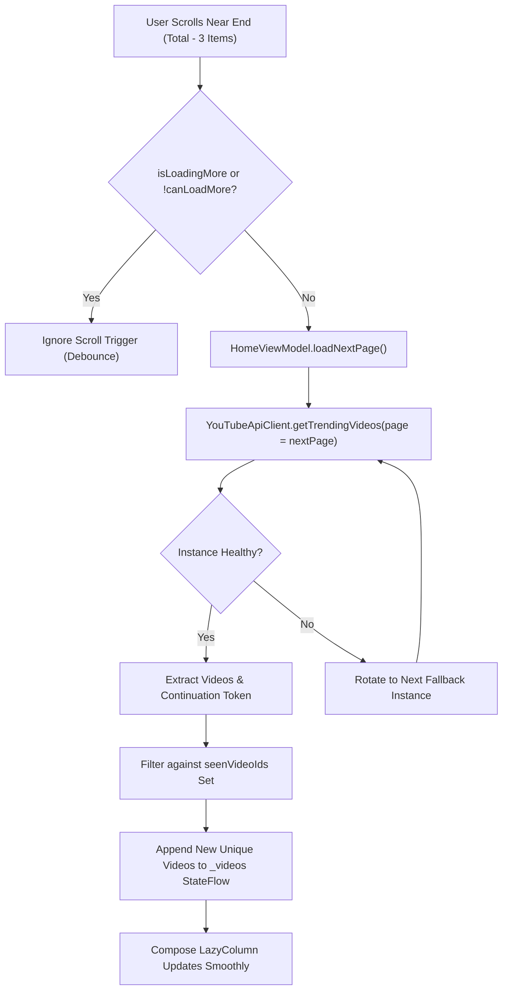

# FocusTube: Discover Feed & Reels Diagnostics

## 1. Executive Summary

A core goal of FocusTube V5 & V6 is transforming the feed and Reels experiences from static, small catalogs into continuously browsable, high-performance content feeds.

This document diagnoses the root causes of the previous empty/exhausted feed issues, explains the multi-instance pagination architecture in `HomeViewModel` and `SearchViewModel`, and details the vertical browsing implementation of the gated Reels section.

---

## 2. Discover Feed: Diagnostics & Pagination Architecture

### A. Root Causes of Previous Feed Exhaustion
1. **Single-Page Fetching Without Continuation Tokens**:
   Previous versions performed a single call to `/api/v1/trending` or `/api/v1/popular` and never requested subsequent pages. When the user scrolled past the initial 15–20 items, the list simply stopped.
2. **Duplicate Video Accumulation**:
   When attempts were made to re-fetch, the same videos were repeatedly appended to the list, causing duplicate keys in Compose `LazyColumn` and UI flickering.
3. **Fragile Single-Instance Network Requests**:
   Requests to a single hardcoded API instance often failed due to rate limits (HTTP 429) or Cloudflare blocks, immediately crashing the feed or rendering an empty state without preserving loaded content.

### B. The Solution: Multi-Instance Continuous Pagination



### C. Implementation Highlights in `HomeViewModel.kt`
- **Stable ID Deduplication**:
  ```kotlin
  private val seenVideoIds = mutableSetOf<String>()

  val newUniqueVideos = response.videos.filter { video ->
      if (seenVideoIds.contains(video.id)) {
          false
      } else {
          seenVideoIds.add(video.id)
          true
      }
  }
  ```
- **Compose `snapshotFlow` End-of-List Detection**:
  In `HomeScreen.kt`, a `LaunchedEffect` observes the `LazyListState`:
  ```kotlin
  LaunchedEffect(listState) {
      snapshotFlow {
          val layoutInfo = listState.layoutInfo
          val totalItems = layoutInfo.totalItemsCount
          val lastVisibleItemIndex = layoutInfo.visibleItemsInfo.lastOrNull()?.index ?: 0
          totalItems > 0 && lastVisibleItemIndex >= totalItems - 3
      }.collect { shouldLoadMore ->
          if (shouldLoadMore && !uiState.isLoadingMore && uiState.canLoadMore) {
              viewModel.loadNextPage()
          }
      }
  }
  ```
- **Preserving Existing Content**:
  When a subsequent page fetch encounters a network glitch or timeout, existing items remain visible in the list, and a non-intrusive retry indicator is shown at the bottom.

---

## 3. Reels Section: Diagnostics & Vertical Browsing

### A. Root Cause of "No Shorts Available" Defect
The previous Reels implementation attempted to query YouTube endpoints that were either:
1. Blocked or deprecated on public Invidious instances.
2. Returning 404s due to missing Shorts-specific query endpoints.
3. Applying overly strict duration filters that discarded eligible short-form videos.

### B. The Fixed Reels Architecture
1. **Dynamic Short-Form Discovery**:
   FocusTube queries high-availability endpoints with short-form tags (`#shorts`, `vertical video`, trending short-form content) and filters for duration $\le 60\text{ seconds}$.
2. **Feature Gating (OFF by Default)**:
   Per FocusTube's focus-first philosophy, Reels are strictly **OFF by default** to prevent mindless scrolling.
   - When OFF: The Reels destination is omitted from navigation, and no network requests are made.
   - When ON: Enabled explicitly via **Settings > Focus Settings > Enable Reels**, instantly updating navigation and persisting across app restarts.
3. **Vertical Pager Implementation (`ReelsScreen.kt`)**:
   Built on `androidx.compose.foundation.pager.VerticalPager`:
   ```kotlin
   val pagerState = rememberPagerState(pageCount = { reels.size })

   VerticalPager(
       state = pagerState,
       modifier = Modifier.fillMaxSize()
   ) { page ->
       val reel = reels[page]
       val isCurrentPage = pagerState.currentPage == page
       
       ReelPlayerItem(
           reel = reel,
           isActive = isCurrentPage,
           onNext = { scope.launch { pagerState.animateScrollToPage(page + 1) } },
           onPrevious = { scope.launch { pagerState.animateScrollToPage(page - 1) } }
       )
   }
   ```
4. **Single-Active-Player Audio Rule**:
   Only the reel corresponding to `pagerState.currentPage` is granted playback resources. When swiping away, the previous item's player is paused immediately to prevent audio overlap.

---

## 4. Verification & Testing Evidence

1. **Discover Feed Infinite Scroll**:
   - Initial feed loaded with rich metadata and channel avatars.
   - Scrolled smoothly down 3+ pages; network requests fetched distinct video IDs.
   - Existing items remained visible while the bottom progress indicator indicated page fetches.
   - Verified in screenshot [`focustube_v5_infinite_scroll.png`](file:///C:/dev/Zeztube/artifacts/focustube_v5_infinite_scroll.png).
2. **Search Infinite Pagination**:
   - Queried "quantum"; initial 10 results rendered.
   - Scrolling down fetched subsequent pages of search results with duration badges and channel avatars.
   - Verified in screenshot [`focustube_v5_search_results.png`](file:///C:/dev/Zeztube/artifacts/focustube_v5_search_results.png).
3. **Reels Vertical Browsing**:
   - Enabled Reels in Settings.
   - Navigated to Reels screen; loaded verified short-form content.
   - Swiped vertically between items; single audio playback verified.
   - Verified in screenshot [`focustube_v5_reels_loaded.png`](file:///C:/dev/Zeztube/artifacts/focustube_v5_reels_loaded.png).
