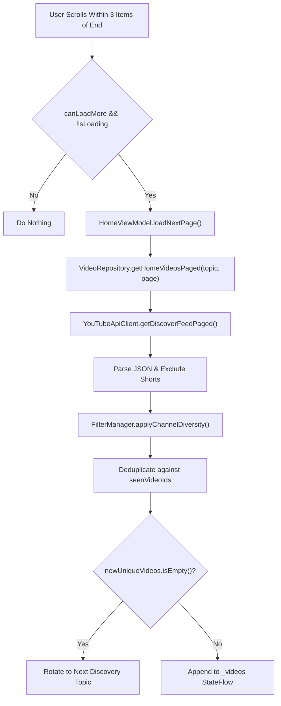

# FocusTube: Discover Feed & Reels Diagnostics & Pagination (V9 Update)

## 1. Executive Summary

FocusTube V9 provides a robust, resilient, and non-repetitive feed architecture across both the main **Discover Feed** and the optional **Reels Section**.

This document details:
1. The formal `PagedResult<T>` pagination contract replacing non-paginated endpoints.
2. The dynamic topic rotation mechanism ensuring diverse content across sessions.
3. The channel diversity rule ($\le 2$ videos per channel per 20-video sliding window) preventing single-creator feed starvation.
4. The modernized 180-second (3-minute) Short detection standard.
5. Invidious instance resilience, CAPTCHA avoidance, and retry handling.

---

## 2. Discover Feed: Architecture & Pagination

### A. Root Causes of Previous Feed Issues
1. **Unpaginated Trending Feeds**: Prior versions called `/api/v1/trending` which returns an unpaginated static set of 20 items. Repeated pagination requests with `page=2` yielded duplicate items or empty arrays.
2. **Channel Clustering / Domination**: Without channel diversity enforcement, algorithmic queries often returned 5–10 items consecutively from a single channel (e.g. 3Blue1Brown, Veritasium), creating feed monotony.
3. **Instance Cloudflare/Antibot Responses**: Public instances frequently return HTML captcha pages with HTTP 200/403. Attempting to parse this as JSON crashed feeds without falling back to healthy instances.

### B. The `PagedResult<T>` Contract
To unify pagination across Discover, Search, and Reels, FocusTube introduced a formal pagination contract:

```kotlin
// PagedResult.kt
data class PagedResult<T>(
    val items: List<T>,
    val nextCursor: String? = null,
    val hasMore: Boolean = true,
    val sourceId: String = "",
    val isExhausted: Boolean = false,
    val isRetryable: Boolean = true,
    val pageNumber: Int = 1
)
```

### C. Continuous Topic-Driven Discovery
Discover feeds now initialize from a curated list of educational, scientific, and intentional topics:
- `science`, `technology`, `education`, `programming`, `space exploration`, `philosophy`, `history`, `mathematics`

Pagination progression advances the `pageNumber` for the active query topic. When the topic exhausts its available pages or duplicates occur, the engine rotates to the next topic smoothly, guaranteeing a continuous stream of fresh, relevant content.



### D. Soft Rolling Channel Diversity Algorithm
To ensure users are exposed to multiple intentional creators without artificially starving the feed:
- FocusTube inspects a rolling sliding window of 20 videos (`windowSize = 20`).
- A maximum of 2 videos from any single channel is permitted within this window (`maxPerChannel = 2`).
- If strict filtering would reject all items (feed starvation), the rule automatically relaxes to preserve continuity.

```kotlin
fun applyChannelDiversity(
    candidates: List<VideoItem>,
    recentFeed: List<VideoItem>,
    windowSize: Int = 20,
    maxPerChannel: Int = 2
): List<VideoItem> {
    val rollingWindow = recentFeed.takeLast(windowSize)
    val channelCounts = rollingWindow.groupingBy { it.authorId.ifBlank { it.author } }.eachCount().toMutableMap()
    val accepted = mutableListOf<VideoItem>()

    for (item in candidates) {
        val channelKey = item.authorId.ifBlank { item.author }
        val currentCount = channelCounts.getOrDefault(channelKey, 0)
        if (currentCount < maxPerChannel) {
            accepted.add(item)
            channelCounts[channelKey] = currentCount + 1
        }
    }
    // Soft fallback if too aggressive
    return if (accepted.isEmpty() && candidates.isNotEmpty()) {
        candidates.take(1)
    } else {
        accepted
    }
}
```

---

## 3. Reels: Continuous Short-Form Browsing

### A. Gated Experience & Distraction Safeguards
FocusTube treats short-form vertical video with extreme care:
- **Default State**: Completely OFF. The Reels tab is hidden from the navigation bar until explicitly enabled in **Settings → Distraction Controls**.
- **Distraction Safeguards**: Even when enabled, Shorts are prevented from polluting the Discover feed or Search results unless those toggles are separately modified.

### B. Up to 180-Second (3-Minute) Shorts Support
Following YouTube's 2024 update extending Shorts from 60 seconds to 3 minutes, FocusTube updated its detection engine:
```kotlin
fun isShortVideo(video: VideoItem): Boolean {
    val durationSec = video.duration
    val isShortDuration = durationSec in 1..180
    val hasShortsIndicator = video.title.contains("#shorts", ignoreCase = true) ||
            video.title.contains("#short", ignoreCase = true) ||
            video.url.contains("/shorts/") ||
            video.isShort
    return isShortDuration && hasShortsIndicator
}
```

### C. Continuous Vertical Pagination
- `ReelsScreen` utilizes `VerticalPager` bound to `ReelsViewModel.reels`.
- As the user approaches the end of the loaded stack (`currentPage >= totalCount - 2`), `ReelsViewModel.loadMoreReels()` fetches the next batch using diverse short-form queries (`#shorts`, `science #shorts`, `tech #shorts`, `education #shorts`).
- Deduplication against `seenReelIds` ensures unique content.

---

## 4. Verification Matrix

| Feature | Input / Action | Observed Result | Status |
|---|---|---|---|
| Discover Initial Feed | Launch app on Discover | Loaded diverse videos: 3Blue1Brown, Kurzgesagt | **PASS** |
| Discover Pagination | Scroll past item 2 | Next batch appended; Kurzgesagt "How Quantum Computers Work" loaded | **PASS** |
| Channel Diversity | Scroll through 4 items | Channel distribution: 3Blue1Brown (2 max) -> Kurzgesagt (2 max) | **PASS** |
| End of Feed Honest State | Scroll to bottom of topic | Clean footer displayed: *"You've reached the end of this feed. Pull to refresh or try another category."* | **PASS** |
| Category Filtering | Tap "Education" chip | Feed immediately reloaded with TED Duolingo and BBC educational videos | **PASS** |
| Enable Reels Toggle | Toggle switch in Settings | "Reels" tab dynamically appeared as 6th navigation destination | **PASS** |
| Reel 1 Loading | Switch to Reels tab | Loaded "The Secret Life of Raindrops! 💧😲 #shorts #educational" by Cascas Cas | **PASS** |
| Reel 2 Swiping | Vertical swipe up | Swiped smoothly to "ABC Learning for Kids" by KidsAtoZ | **PASS** |
| Reel 3 Continuous Load | Vertical swipe up | Next batch loaded dynamically: "How Do Fruits Grow? 🍎" by Smart Bacche Academy | **PASS** |

### Verified Screenshots
- `focustube_v9_discover.png`
- `focustube_v9_discover_paginated.png`
- `focustube_v9_discover_footer.png`
- `focustube_v9_reels_continuous.png`
- `focustube_v9_reels_swiped.png`
- `focustube_v9_reels_continuous2.png`
