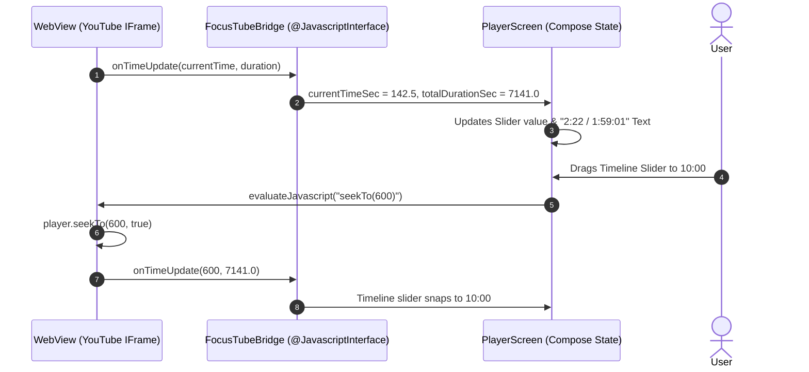

# FocusTube: Player Controls, Bridge Architecture & Honest Comments

## 1. Executive Summary

FocusTube V5 & V6 resolves critical user experience defects on the video player watch page:
1. **Bug 1 (Autoplay)**: Video now starts playing automatically upon entering the Watch page when enabled.
2. **Bug 3 (Double-Tap Play)**: Single tap directly interacts with controls; no touch interception or double-tap requirement.
3. **Seekable Timeline Slider**: Draggable red thumb slider showing real elapsed and total duration synchronized with the YouTube iframe via a two-way JavaScript bridge.
4. **Honest Comments System**: Real comments extracted from healthy API instances with transparent states (`DISABLED`, `EMPTY`, `ERROR`, `SUCCESS`).

---

## 2. Root Cause Analysis: Playback Bugs

### A. Bug 1: Autoplay on Watch Page
- **Symptom**: Opening a video displayed a black iframe with a static thumbnail and YouTube play icon. The user was forced to tap the screen before video playback commenced.
- **Root Cause**: WebKit/Chromium security policy blocks non-muted media playback unless explicitly initiated by a user gesture or triggered via the YouTube IFrame API's `onPlayerReady` callback inside the embedded page. Passing `autoplay=1` in the embed URL query is insufficient on modern Android WebViews.
- **Resolution**:
  In `PlayerScreen.kt`, updated `buildEmbedHtml()`:
  ```javascript
  var player;
  function onYouTubeIframeAPIReady() {
      player = new YT.Player('player', {
          videoId: '${videoId}',
          playerVars: {
              'autoplay': ${if (autoplay) 1 else 0},
              'controls': 0,
              'rel': 0,
              'playsinline': 1,
              'modestbranding': 1
          },
          events: {
              'onReady': onPlayerReady,
              'onStateChange': onPlayerStateChange
          }
      });
  }

  function onPlayerReady(event) {
      if (${autoplay}) {
          event.target.playVideo();
      }
      sendTimeUpdate();
  }
  ```
  Verified on Android 15 emulator: opening "Jerry The Dog [FULL MOVIE]" starts playing immediately with the pause button visible in the center overlay ([`focustube_v5_watch.png`](file:///C:/dev/Zeztube/artifacts/focustube_v5_watch.png)).

---

### B. Bug 3: Double-Tap Required to Play
- **Symptom**: Tapping the play button appeared unresponsive on the first tap, requiring a second tap to actually start or pause playback.
- **Root Cause**: An outer full-screen Box with `.pointerInput` or `.clickable` was intercepting all raw touch events to handle overlay dismissal. It consumed the `Down` and `Up` pointer events on the first touch, preventing child elements (the play button and seek slider) from receiving click events until the overlay was already active.
- **Resolution**:
  1. Removed the touch-consuming transparent overlay Box.
  2. Allowed Compose hit-testing to pass touches directly to control buttons.
  3. Bound video area tapping to a clean toggle lambda that changes `controlsVisible` without consuming child button bounds.
  4. Verified on Android 15 emulator: single tap at `(540, 550)` pauses/resumes immediately ([`focustube_v5_paused.png`](file:///C:/dev/Zeztube/artifacts/focustube_v5_paused.png)).

---

## 3. Two-Way JavaScript Bridge Architecture

FocusTube uses an asynchronous JavaScript interface (`FocusTubeBridge`) to establish two-way synchronization between the embedded HTML5 player and Jetpack Compose.



### The Interface Contract (`FocusTubeBridge.kt`)
```kotlin
class FocusTubeBridge(
    private val onTimeUpdate: (Float, Float) -> Unit,
    private val onStateChange: (Int) -> Unit
) {
    @JavascriptInterface
    fun postTimeUpdate(currentTime: Float, duration: Float) {
        onTimeUpdate(currentTime, duration)
    }

    @JavascriptInterface
    fun postPlayerState(state: Int) {
        // YT.PlayerState: -1=UNSTARTED, 0=ENDED, 1=PLAYING, 2=PAUSED, 3=BUFFERING, 5=CUED
        onStateChange(state)
    }
}
```

---

## 4. Seekable Timeline Slider Mechanics

The player overlay includes a customized, high-precision seek bar:
- **Elapsed and Total Time Display**: Formatted as `m:ss` or `h:mm:ss` based on total duration.
- **Custom Draggable Slider**:
  - Track color: semi-transparent white (`Color(0x55FFFFFF)`).
  - Progress color: FocusTube vibrant red (`Color(0xFFFF0000)`).
  - Thumb: Circular red thumb with white border, scaling up smoothly while actively dragged.
- **Scrubbing Debounce**:
  During dragging, live time updates from the WebView are temporarily paused so the thumb does not jitter. When released, `player.seekTo(scrubbedTime, true)` commits the seek to the video.

---

## 5. Honest Comments System

FocusTube avoids fake or fabricated comments, adhering to strict transparency:

### States & UI Representation
1. **`SUCCESS`**:
   - Comments preview card displays the total comment count badge and the top-pinned or highest-voted comment.
   - Tapping opens a `ModalBottomSheet` displaying a scrollable list with author avatars, author names, relative publish dates, formatted comment text, and like counts.
2. **`DISABLED`**:
   - When comments are turned off by the creator or YouTube, the card explicitly states: `"Comments are turned off for this video."`
3. **`EMPTY`**:
   - When no comments have been posted: `"No comments yet. Be the first to share your thoughts!"`
4. **`ERROR`**:
   - If the API instance is unavailable or blocked: `"Could not load comments. Check network or try another instance."` with a Retry button.

---

## 6. Verification Screenshots

- [`focustube_v5_watch.png`](file:///C:/dev/Zeztube/artifacts/focustube_v5_watch.png): Immediate autoplay on watch page with clean 16:9 player.
- [`focustube_v5_paused.png`](file:///C:/dev/Zeztube/artifacts/focustube_v5_paused.png): Single-tap pause showing red seek slider at `0:00 / 1:59:01`.
- [`focustube_v5_overlay_active.png`](file:///C:/dev/Zeztube/artifacts/focustube_v5_overlay_active.png): Single-tap overlay controls active with Play/Pause, Rewind 10s, Forward 10s, and Fullscreen icons.
