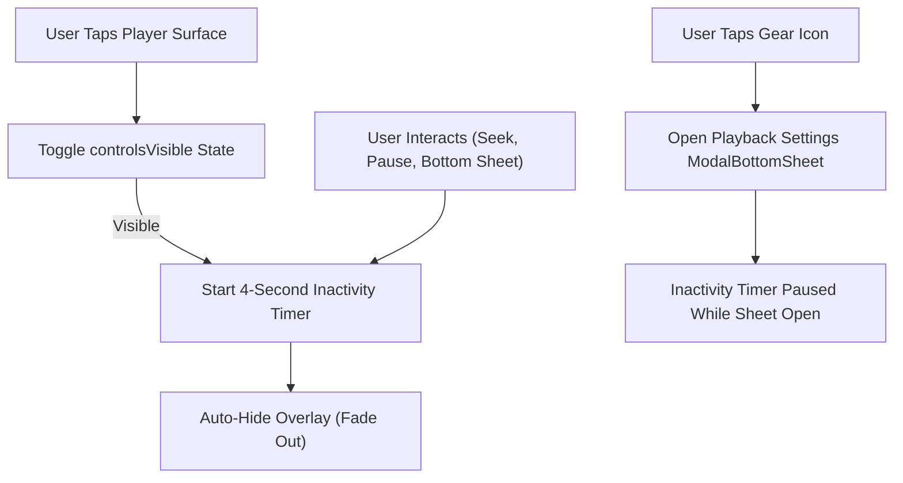

# FocusTube V4: Video Player Overlay & Settings Menu Cleanup

## 1. Overview & Problem Diagnosis

In previous versions of FocusTube, the video watch screen suffered from severe UI crowding and visual obstruction during playback:
- **Redundant Top Toolbar Controls**: The watch page header contained separate icon buttons for Speed, Sleep Timer, and Share, cluttering the navigation bar.
- **Persistent Overlay Chrome**: Player controls, title bars, and share buttons remained visible over the video, obstructing educational diagrams, subtitles, and presentation slides.
- **Embedded Player Clutter**: The YouTube iframe displayed oversized overlays, watermarks, and related video cards when not properly configured with privacy parameters.
- **Scattered Settings**: Controls for playback speed, quality, and sleep timers were spread across different screens and headers rather than being accessible within the player context.

---

## 2. Solution Architecture

To deliver a distraction-free, YouTube-inspired viewing experience, the player overlay was rebuilt around three key pillars:

### A. Auto-Hiding Controls with Inactivity Timer
- **4-Second Inactivity Timeout**: When the user taps the player surface, controls smoothly fade in (`fadeIn()`). A coroutine timer resets after 4 seconds of inactivity and fades controls out (`fadeOut()`).
- **Interactive Reset**: Tapping Rewind (-10s), Fast Forward (+10s), Play/Pause, or opening the settings sheet resets the 4-second timer to prevent the controls from vanishing mid-action.
- **Tap-to-Toggle**: Tapping anywhere on the video player surface instantly toggles overlay visibility without interfering with playback.

### B. Consolidated Player Settings Menu (`ModalBottomSheet`)
All non-essential toolbar buttons were consolidated into a single **Settings Gear Icon** in the watch header and overlay. Tapping this gear opens a sleek, responsive `ModalBottomSheet` containing:
1. **Playback Quality Selector**:
   - Offers `Auto`, `1080p`, `720p`, `480p`, `360p`, `240p`.
   - Displays clear status indicating whether adaptive bitrate or manual resolution is active.
2. **Playback Speed Control (0.25× to 3.0×)**:
   - Full 12-step speed range: `0.25×`, `0.5×`, `0.75×`, `1.0×`, `1.25×`, `1.5×`, `1.75×`, `2.0×`, `2.25×`, `2.5×`, `2.75×`, `3.0×`.
   - Displayed in a horizontally scrollable chip row with active speed highlighted in `FocusBlue`.
3. **Study & Sleep Timer**:
   - Preset durations: `Off`, `15m`, `30m`, `45m`, `60m`.
   - Real-time countdown indicator showing remaining minutes (e.g. `Study Timer Active (14m remaining)`).
   - Instant cancel action by tapping `Off`.
4. **Background Audio Toggle**:
   - Directly toggles the `backgroundAudioEnabled` preference.
   - Activates `FocusTubeMediaService` for lockscreen and background audio.
5. **Direct Share Action**:
   - One-tap intent to share the canonical YouTube video URL via Android's native share sheet.

### C. Clean Privacy Embed
- Embedded WebView player is isolated within a dedicated 16:9 container (`aspectRatio(16f / 9f)`) in portrait, and switches to edge-to-edge fullscreen (`fillMaxSize()`) in landscape.
- Embedded parameters configured: `modestbranding=1`, `rel=0`, `iv_load_policy=3`, `controls=1`, `playsinline=1`.

---

## 3. Files Modified
- [`PlayerScreen.kt`](file:///C:/dev/Zeztube/app/src/main/java/com/focustube/app/ui/screens/player/PlayerScreen.kt): Implemented `VideoPlayerControlsOverlay`, inactivity timer, tap-to-toggle gesture, consolidated top bar, and `PlaybackSettingsSheet`.
- [`PlayerViewModel.kt`](file:///C:/dev/Zeztube/app/src/main/java/com/focustube/app/ui/screens/player/PlayerViewModel.kt): Added `isSettingsSheetOpen`, `selectedQuality`, `cancelSleepTimer()`, and `toggleBackgroundAudio()`.
